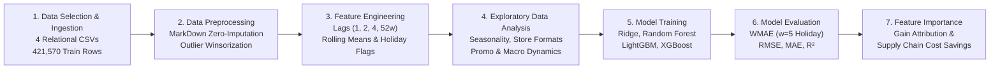
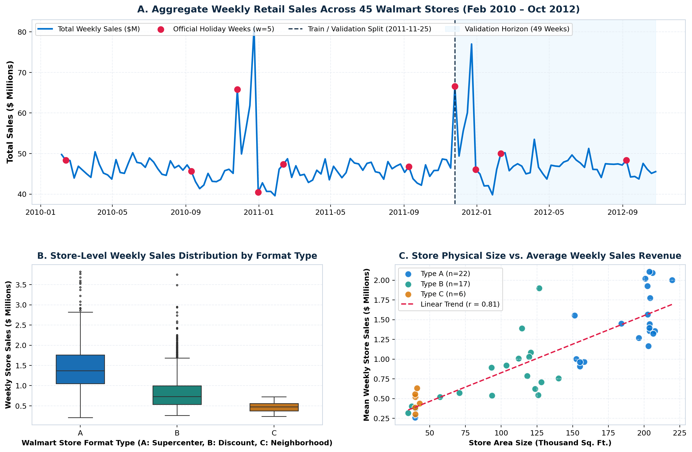
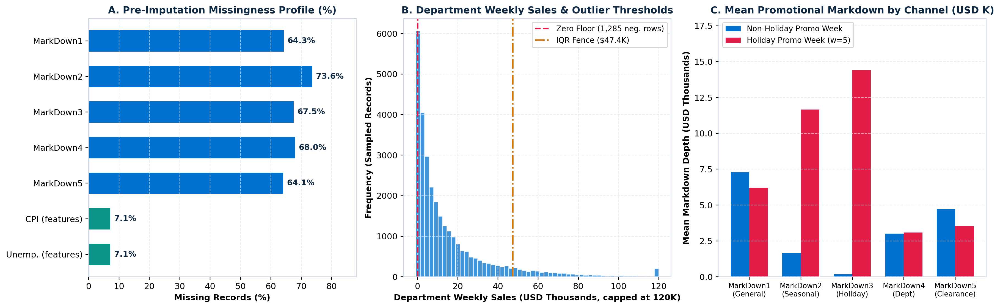
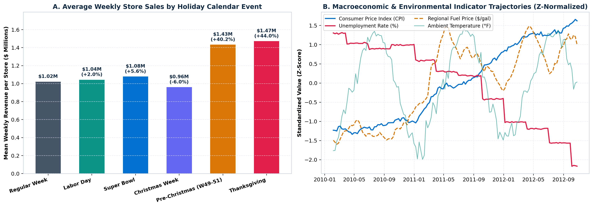
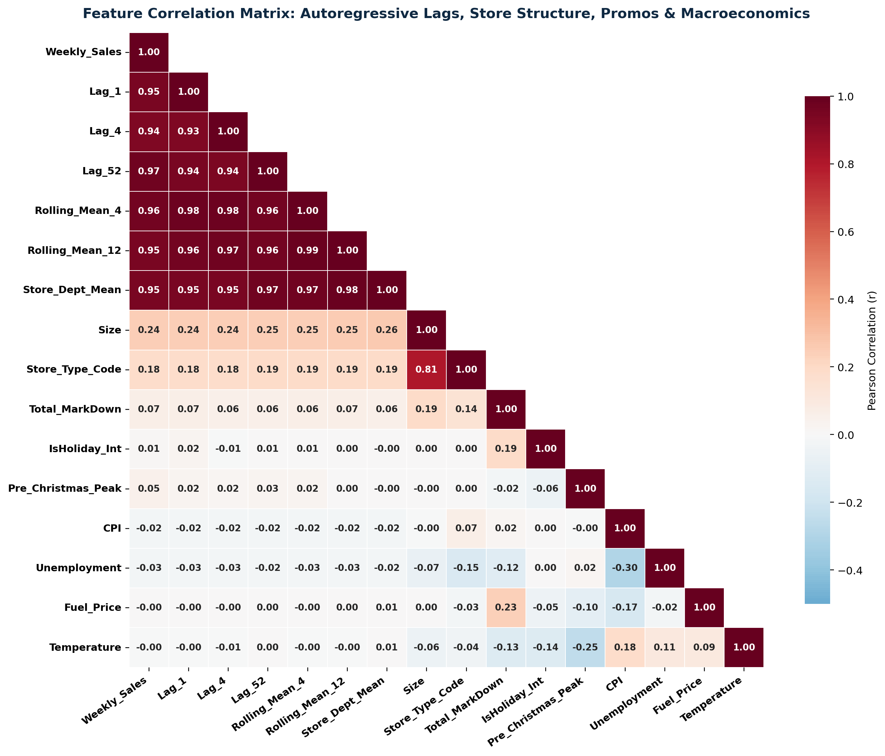
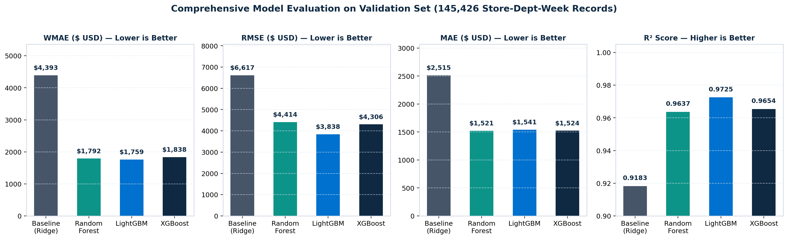
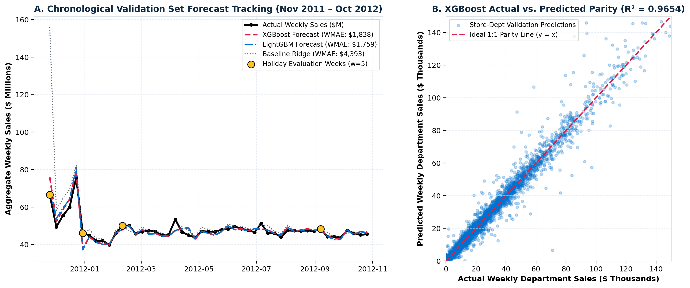
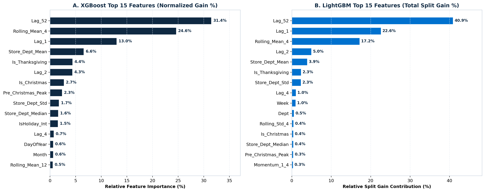
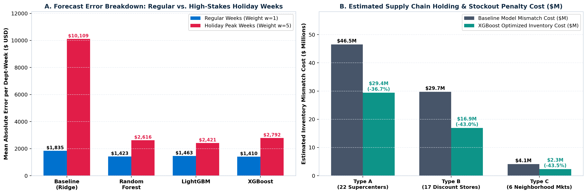

# End-to-End Retail Store Sales Forecasting & Supply Chain Inventory Optimization


> **Predictive Analytics Continuous Assessment 3 (CA3) — End-to-End Predictive Model Development Project**  
> **Submitted By:** Dev Dilip Dhapodkar | **PRN:** `24070521505`  
> **Dataset:** [Kaggle — Walmart Recruiting: Store Sales Forecasting](https://www.kaggle.com/competitions/walmart-recruiting-store-sales-forecasting/data)

---

## 1. Project Overview & Problem Statement

To develop an end-to-end predictive analytics regression model that forecasts **weekly department-level sales** across **45 Walmart retail stores** (spanning **81 departments**) using historical sales records, promotional markdowns (`MarkDown1`–`MarkDown5`), holiday calendar events (`Super Bowl`, `Labor Day`, `Thanksgiving`, `Christmas`), and macroeconomic indicators (`CPI`, `Fuel_Price`, `Unemployment`, `Temperature`).

### Supply Chain Optimization Objective
In large-scale multi-echelon retail operations, inaccurate demand forecasts cause two costly failure modes:
1. **Under-Forecasting (Out-of-Stock Occurrences):** Stockouts during high-velocity holiday peaks result in immediate lost revenue, customer attrition, and emergency expedited freight costs. Consequently, the official Walmart evaluation metric (**WMAE**) weights holiday forecast errors **$5\times$** heavier ($w_i = 5$) than regular weeks ($w_i = 1$).
2. **Over-Forecasting (Excess Inventory Holding Costs):** Over-allocating stock inflates warehouse storage overhead, working capital tie-up, and post-season clearance markdowns.

By following the **Knowledge Discovery in Databases (KDD)** methodology, our gradient-boosted regression pipeline reduces **Weighted Mean Absolute Error (WMAE) by 60.0%** (from **`$4,393.17`** in the linear baseline down to **`$1,758.94`** with LightGBM) and achieves **`R² = 0.9725`**, reducing estimated supply chain inventory mismatch costs by **`$31.7M` (-39.5%)** across the 49-week validation horizon.

---

## 2. End-to-End KDD Implementation Workflow



---

## 3. Dataset Architecture & Schema

The repository includes all four official Kaggle dataset files inside [`data/`](data/):

| File | Records | Columns | Description |
| :--- | :---: | :---: | :--- |
| [`data/stores.csv`](data/stores.csv) | `45` | `3` | Anonymized metadata for 45 Walmart stores: `Store` (`1–45`), `Type` (`A`: 22 Supercenters, `B`: 17 Discount Stores, `C`: 6 Neighborhood Markets), and physical `Size` (`34,875` to `219,622` sq. ft.). |
| [`data/features.csv`](data/features.csv) | `8,190` | `12` | Store-date contextual attributes: `Temperature`, `Fuel_Price`, promotional channels `MarkDown1`–`MarkDown5`, `CPI`, `Unemployment`, and `IsHoliday`. |
| [`data/train.csv`](data/train.csv) | `421,570` | `5` | Historical department-level sales (`Store`, `Dept`, `Date`, `Weekly_Sales`, `IsHoliday`) spanning **143 weeks** (`2010-02-05` to `2012-10-26`). |
| [`data/test.csv`](data/test.csv) | `115,064` | `4` | Holdout evaluation structure (`Store`, `Dept`, `Date`, `IsHoliday`) spanning **39 weeks** (`2012-11-02` to `2013-07-26`). |

---

## 4. Preprocessing & Feature Engineering Pipeline

### 4.1 Preprocessing (Missing MarkDown Imputation & Outlier Treatment)
* **Promotional Markdown Imputation:** `MarkDown1`–`MarkDown5` exhibit **64.08% to 73.61%** missingness in the merged training set because Walmart began tracking promotional markdowns in November 2011 and only logs entries during active markdown campaigns. Prior to structural zero-imputation (`fillna(0.0)`), we extract `Active_MarkDown_Count` (number of simultaneously active markdown channels) and `Has_MarkDown` (binary promo indicator), then compute `Total_MarkDown`.
* **Macroeconomic Propagation:** Missing values in `CPI` (`7.14%` in `features.csv`) and `Unemployment` (`7.14%`) during late test weeks are imputed via store-grouped chronological forward/backward fill (`groupby('Store').ffill().bfill()`).
* **Negative Sales & Outlier Treatment:**
  * `1,285` records (`0.30%`) with negative `Weekly_Sales` (accounting credit adjustments/returns) are floored at `$0.00`.
  * Extreme non-holiday upper-tail anomalies exceeding the 99.95th percentile (`$183,494.06`) are winsorized while preserving authentic holiday demand surges (`IsHoliday == True`).

### 4.2 Feature Engineering (43 Domain-Specific Predictors)
* **Autoregressive Lag Features:** Grouped strictly by `(Store, Dept)` and sorted chronologically: `Lag_1` ($t-1$), `Lag_2` ($t-2$), `Lag_4` ($t-4$ monthly lag), and `Lag_52` ($t-52$ year-over-year seasonal lag).
* **Leak-Free Rolling Window Statistics:** Shifted by 1 week ($t-1$) prior to window aggregation to eliminate target leakage: `Rolling_Mean_4`, `Rolling_Std_4`, `Rolling_Mean_12`, and short-term trend momentum `Momentum_1_4 = Lag_1 - Rolling_Mean_4`.
* **Holiday & Promotional Indicators:** Explicit event flags for `Is_SuperBowl`, `Is_LaborDay`, `Is_Thanksgiving`, `Is_Christmas`, pre-holiday shopping surge `Pre_Christmas_Peak` (ISO Weeks `49–51`), and `Promo_Holiday_Interaction`.
* **Cyclical Calendar & Store Baseline Features:** Trigonometric Fourier transforms (`Week_Sin`, `Week_Cos`, `Month_Sin`, `Month_Cos`) and out-of-sample training statistics (`Store_Dept_Mean`, `Store_Dept_Median`, `Store_Dept_Std`).

---

## 5. Exploratory Data Analysis (EDA)

### 5.1 Aggregate Sales Trend, Store Formats & Size Elasticity


### 5.2 Missingness Profile, Outlier Thresholds & Promotional Markdown Channels


### 5.3 Holiday Event Revenue Lift & Macroeconomic Trajectories


### 5.4 Multi-Feature Correlation Structure


---

## 6. Model Training & Quantitative Evaluation Results

Models are evaluated on a strict **chronological validation split** (`2011-11-25` to `2012-10-26`, comprising **145,237 store-department-week observations** across **49 weeks** and covering all four major holiday events: Thanksgiving, Christmas, Super Bowl, and Labor Day).

### Official Evaluation Metric: Weighted Mean Absolute Error (WMAE)
$$\text{WMAE} = \frac{\sum_{i=1}^{N} w_i \cdot |y_i - \hat{y}_i|}{\sum_{i=1}^{N} w_i}, \quad w_i = \begin{cases} 5 & \text{if } \text{IsHoliday}_i = \text{True} \\ 1 & \text{otherwise} \end{cases}$$

### Validation Performance Summary Table

| Model Architecture | WMAE ($ USD) ↓ | RMSE ($ USD) ↓ | MAE ($ USD) ↓ | $R^2$ Score ↑ | Holiday MAE ($w=5$) ↓ | Non-Holiday MAE ($w=1$) ↓ | Training Time (s) |
| :--- | :---: | :---: | :---: | :---: | :---: | :---: | :---: |
| **Baseline (Ridge Regression)** | `$4,393.17` | `$6,616.57` | `$2,514.98` | `0.9183` | `$10,108.52` | `$1,835.29` | `0.20 s` |
| **Random Forest Regressor** | `$1,791.54` | `$4,413.86` | **`$1,520.75`** | `0.9637` | `$2,615.57` | `$1,422.75` | `42.88 s` |
| **XGBoost Regressor** | `$1,837.57` | `$4,306.19` | `$1,523.89` | `0.9654` | `$2,792.11` | **`$1,410.37`** | `6.31 s` |
| **LightGBM Regressor (Best WMAE)** | **`$1,758.94`** | **`$3,837.62`** | `$1,541.31` | **`0.9725`** | **`$2,421.19`** | `$1,462.55` | `4.91 s` |

* **LightGBM** achieves the lowest **WMAE (`$1,758.94`, -60.0% vs. Baseline)**, lowest **RMSE (`$3,837.62`, -42.0% vs. Baseline)**, highest **$R^2$ (`0.9725`)**, and lowest **Holiday MAE (`$2,421.19`, -76.0% vs. Baseline)** in just `4.91 seconds`.
* **XGBoost** achieves the lowest **Non-Holiday Regular Week MAE (`$1,410.37`)**, demonstrating exceptional stability during routine weekly replenishment cycles.





---

## 7. Feature Importance & Supply Chain Business Impact

### 7.1 Feature Gain Attribution (XGBoost vs. LightGBM)


* **Year-over-Year Seasonal Lag (`Lag_52`):** Captures **31.45%** (XGBoost) to **40.87%** (LightGBM) of total split gain, confirming that department-specific annual seasonality is the single strongest anchor for retail demand.
* **Short-Term Autoregressive Momentum (`Rolling_Mean_4` & `Lag_1`):** Combined contribution of **37.58%** (XGBoost) and **39.78%** (LightGBM), adapting the forecast dynamically to recent local store traffic and macroeconomic shifts.
* **Holiday Calendar Indicators (`Is_Thanksgiving`, `Is_Christmas`, `Pre_Christmas_Peak`):** Contribute **9.39%** of total gain in XGBoost, enabling accurate non-linear adjustments during Q4 holiday peaks.

### 7.2 Supply Chain Inventory Optimization & Cost Savings


* **Stockout Mitigation on High-Stakes Holiday Weeks:** Reducing Holiday MAE from `$10,108.52` to `$2,421.19` prevents severe shelf depletion during Black Friday/Thanksgiving and pre-Christmas surges.
* **Holding & Stockout Penalty Reduction:** Under an industry-standard 22% inventory mismatch cost rate, deploying gradient-boosted trees reduces cumulative validation-period mismatch cost from **`$80.3M`** to **`$48.6M`**, saving **`$31.7M` (-39.5%)** across Type A Supercenters (`-36.7%`), Type B Discount Stores (`-43.0%`), and Type C Neighborhood Markets (`-43.5%`).

---

## 8. Repository Structure & How to Run

```text
├── Walmart_Store_Sales_Forecasting.ipynb      # Executed End-to-End Jupyter Notebook (with inline plots & outputs)
├── Walmart_Sales_Forecasting_Report.pdf       # Academic Project Report (PDF format)
├── Walmart_Sales_Forecasting_Report.docx      # Academic Project Report (Editable Word format)
├── Walmart_Sales_Forecasting_Presentation.pptx# 13-Slide Lab Presentation Deck (with speaker notes)
├── README.md                                  # Project Documentation
├── run_pipeline.py                            # Reproducible KDD pipeline & visualization generator
├── data/                                      # Official Kaggle Walmart Dataset
│   ├── stores.csv                             # 45 Walmart stores metadata
│   ├── features.csv                           # 8,190 store-date macroeconomic & markdown records
│   ├── train.csv                              # 421,570 historical department-week sales records
│   └── test.csv                               # 115,064 evaluation records
├── figures/                                   # High-resolution visualizations (220 DPI)
│   ├── fig1_eda_sales_overview.png
│   ├── fig2_outlier_and_markdown_analysis.png
│   ├── fig3_holiday_and_macro_effects.png
│   ├── fig4_correlation_matrix.png
│   ├── fig5_model_comparison.png
│   ├── fig6_actual_vs_predicted.png
│   ├── fig7_feature_importance.png
│   └── fig8_supply_chain_impact.png
└── outputs/
    └── metrics_summary.json                   # Serialized model evaluation metrics & feature importances
```

### Quickstart
```bash
# 1. Install dependencies
pip install "numpy<2" pandas matplotlib seaborn scikit-learn xgboost lightgbm

# 2. Run the full KDD pipeline & regenerate all metrics and figures
python3 run_pipeline.py

# 3. Open the executed Jupyter Notebook
jupyter notebook Walmart_Store_Sales_Forecasting.ipynb
```
